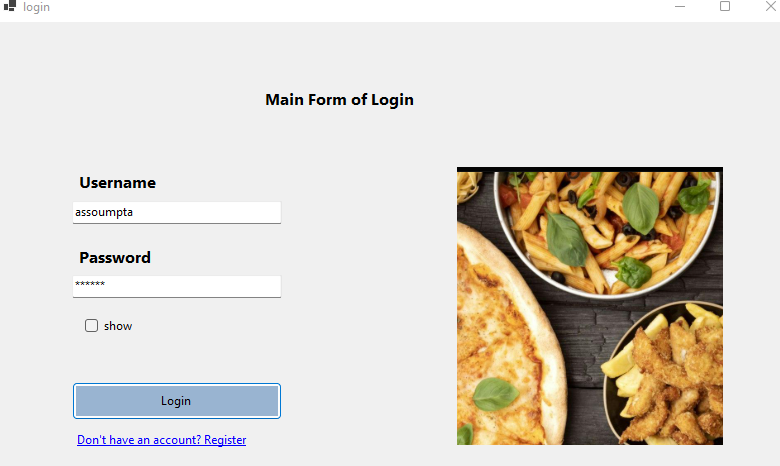
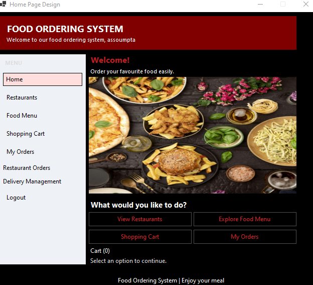
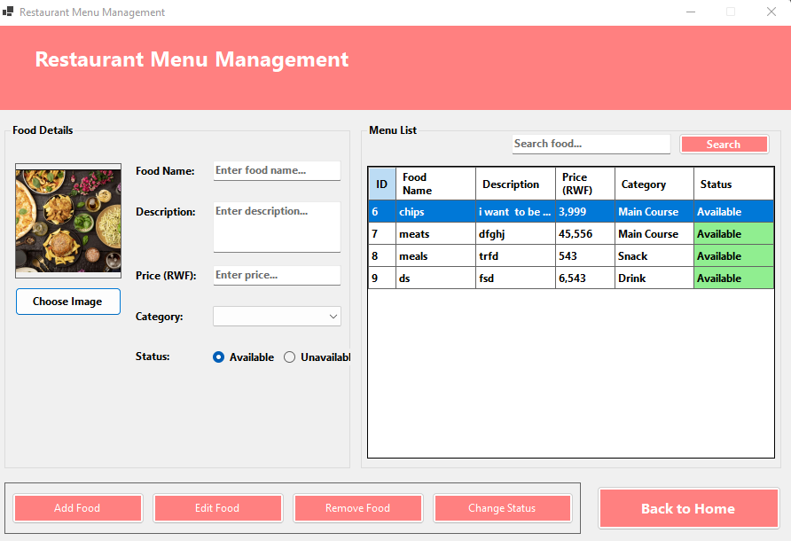
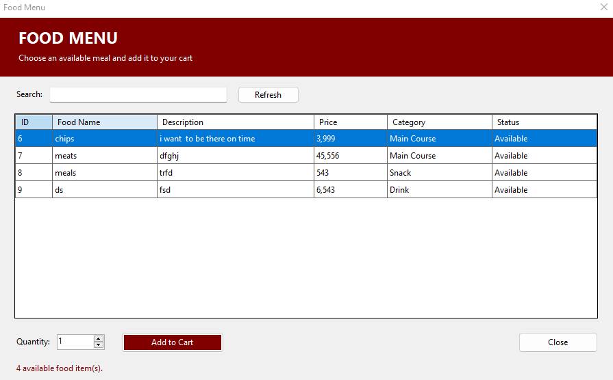
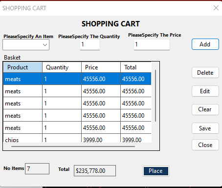
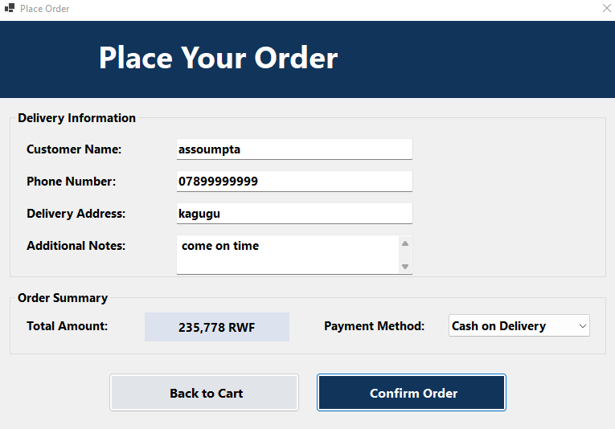
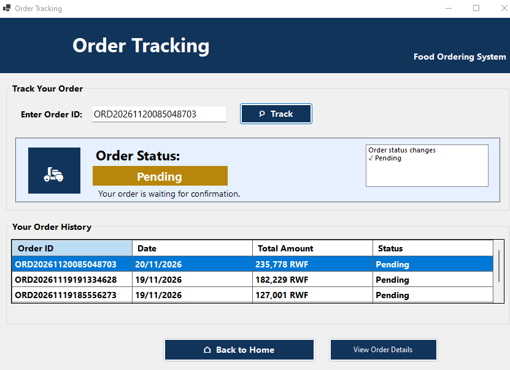
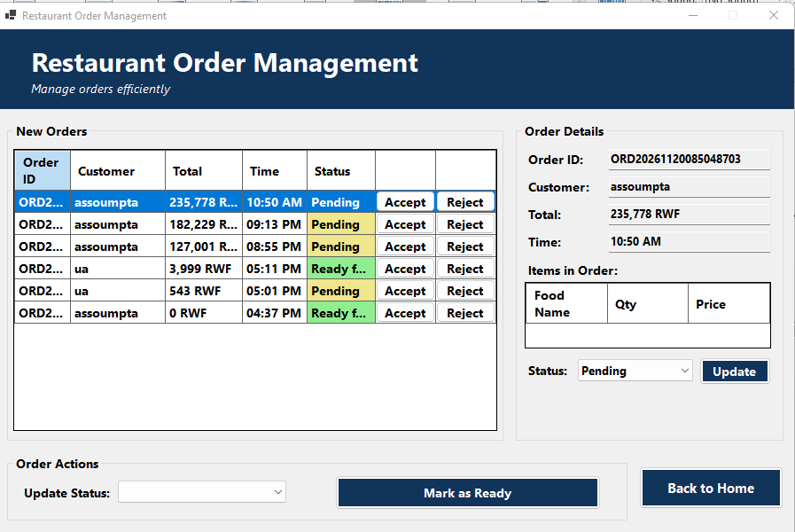
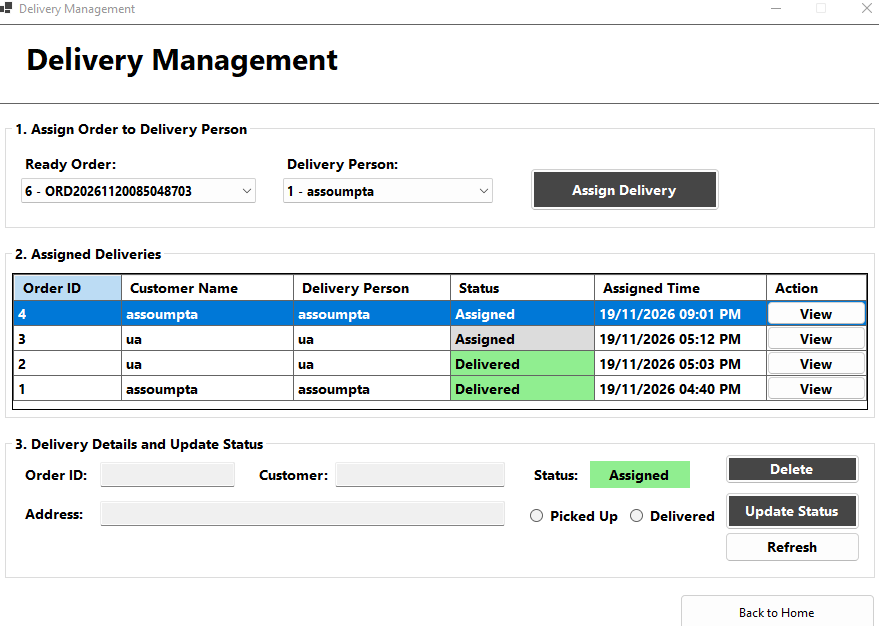
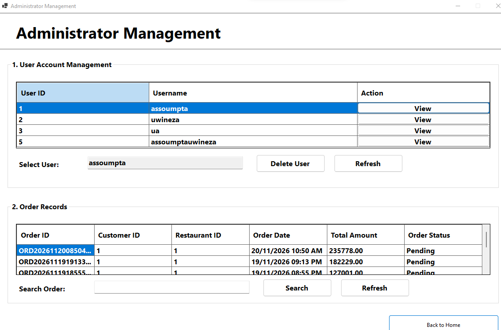

# Food Ordering Management System

## Project Information

| Field | Details |
| --- | --- |
| **Student name** | Uwineza Assoumpta |
| **Student ID** | 26243 |
| **Course name** | Dotnet |
| **Lecturer name** | Ndagijimana Adonia |
| **Project name** | Food Ordering Management System |

---

A Windows desktop food-ordering application built with WinForms and .NET 10. The application allows customers to browse a restaurant menu, manage a shopping cart, place orders, and follow order progress. It also provides screens for restaurant order processing, delivery management, and administrator account/order management.

> The project folder and namespace are currently named `foododering` (one `r` in `odering`).

## Features

### Customer

- Register a new customer account.
- Log in using a username and password.
- Browse the restaurant menu and search by food name or category.
- Add available food items to the shopping cart.
- Change quantities, remove items, and clear the cart.
- Enter contact and delivery information.
- Select a payment method and place an order.
- View generated order numbers and track order status.

### Restaurant

- Add food items with a name, description, price, category, and availability status.
- Edit and delete menu items.
- Mark menu items as available or unavailable.
- Review incoming orders.
- Accept, reject, and update order statuses.
- Move orders through the workflow: `Pending`, `Accepted`, `Preparing`, `Ready for Pickup`, `Out for Delivery`, `Delivered`, or `Cancelled`.

### Delivery

- View orders that are ready for delivery.
- Assign an order to a delivery person.
- Update delivery status to `PickedUp` or `Delivered`.
- View assigned delivery details and remove delivery records when necessary.

### Administrator

- Review registered user accounts.
- Delete user accounts.
- Search and refresh orders.
- Review order numbers, customers, restaurants, dates, totals, and statuses.

## How the application works

1. The application starts at the login form.
2. A customer registers or logs in with an existing account.
3. After login, the customer opens the food menu and adds available items to the cart.
4. The customer reviews the cart and opens the order form.
5. The customer provides a phone number, delivery address, and payment method.
6. The application creates an order with a generated number such as `ORD20240101123000123`, clears the database cart, and opens order tracking.
7. Restaurant staff update the order status as it is prepared.
8. Delivery staff assign and update delivery records until the order is delivered.
9. The customer can use order tracking to view the current status and order history.

## Technology stack

- .NET 10 (`net10.0-windows`)
- C#
- Windows Forms
- MySQL
- `MySqlConnector` 2.4.0
- `MySql.Data` 26.10.0

The code is organized into the following areas:

| Folder | Responsibility |
| --- | --- |
| `view` | WinForms screens and Designer-generated UI code |
| `controller` | Application operations and input validation |
| `DAO` | Database queries and persistence |
| `Model` | Data models used by the application |
| `connection` | MySQL connection configuration |
| `Properties` and `Resources` | Application resources and images |

## Requirements

- Windows
- Visual Studio with .NET 10 SDK and Windows Forms workload
- MySQL Server running locally
- A MySQL database named `foodorderingdb`

## Database configuration

The application currently uses this connection string in `connection/DatabaseConnection.cs`:

```text
Server=127.0.0.1;Port=3306;Database=foodorderingdb;User ID=root;Password=;
```

Before running the application:

1. Start MySQL Server.
2. Create the `foodorderingdb` database.
3. Create the tables expected by the DAOs: `users`, `restaurants`, `menuitems`, `carts`, `cartitems`, `orders`, and `deliveries`.
4. Ensure the MySQL user, password, host, and port match the connection string.
5. If your MySQL installation uses a password for `root`, update the connection string before running the application.

The application creates the default restaurant record with ID `1` and name `Food Ordering Restaurant` when it starts or when a menu screen is opened. The remaining database tables must exist before registration, menu management, cart, order, or delivery operations are used.

### Tables used by the application

The database layer expects the following main columns and relationships:

- `users`: `UserId`, `Name`, `Password`
- `restaurants`: `RestaurantId`, `RestaurantName`
- `menuitems`: `MenuItemId`, `RestaurantId`, `ItemName`, `Description`, `Price`, `Category`, `IsAvailable`
- `carts`: `CartId`, `CustomerId`
- `cartitems`: `CartItemId`, `CartId`, `MenuItemId`, `Quantity`, `UnitPrice`
- `orders`: `OrderId`, `OrderNumber`, `CustomerId`, `RestaurantId`, `DeliveryAddress`, `OrderDate`, `TotalAmount`, `OrderStatus`, `PaymentStatus`
- `deliveries`: `DeliveryId`, `OrderId`, `DeliveryPersonId`, `DeliveryStatus`, `AssignedAt`, `PickedUpAt`, `DeliveredAt`

The order and delivery queries also require relationships between users, restaurants, menu items, carts, cart items, orders, and deliveries. Foreign keys are recommended to preserve data consistency.

## Running the project

From Visual Studio:

1. Open `foododering.slnx`.
2. Restore NuGet packages.
3. Confirm the MySQL service and database are available.
4. Set `foododering` as the startup project.
5. Build and run the project.

From PowerShell in the repository directory:

```powershell
dotnet restore
dotnet build
dotnet run --project .\foododering.csproj
```

## Login accounts

### Customer account

Use the **Register** link on the login screen to create a customer account. Passwords must contain at least six characters, and the username must not be `admin`.

### Administrator demo account

The login form contains a built-in administrator demo login:

- Username: `admin`
- Password: `admin123`

This demo login opens the administrator management screen without authenticating against the database. Change this behavior before using the application in production.

## Important implementation notes

- The default order is created for restaurant ID `1`.
- Prices and totals are displayed in RWF in the order screens.
- Customer passwords are stored using PBKDF2 hashing when a new account is registered.
- The application currently keeps the database connection string directly in source code. A production version should move credentials to secure configuration or environment variables.
- `MySqlConnector` and `MySql.Data` are both referenced. The application database classes primarily use `MySqlConnector`; the package references should be reviewed and simplified if the second package is not required.
- The current cart UI keeps a display list in memory and also synchronizes customer carts with the database when a logged-in customer is used.

## Project status

This is a WinForms desktop application under active development. Database setup scripts, automated tests, production authentication, and secure configuration should be added before deployment to a production environment.

## Application Screenshots

The following screenshots are stored in the project's `screenshot` folder and show the main screens of the Food Ordering Management System.

### Screenshot 1



### Screenshot 2



### Screenshot 3



### Screenshot 4



### Screenshot 5



### Screenshot 6



### Screenshot 7



### Screenshot 8



### Screenshot 9



### Screenshot 10


